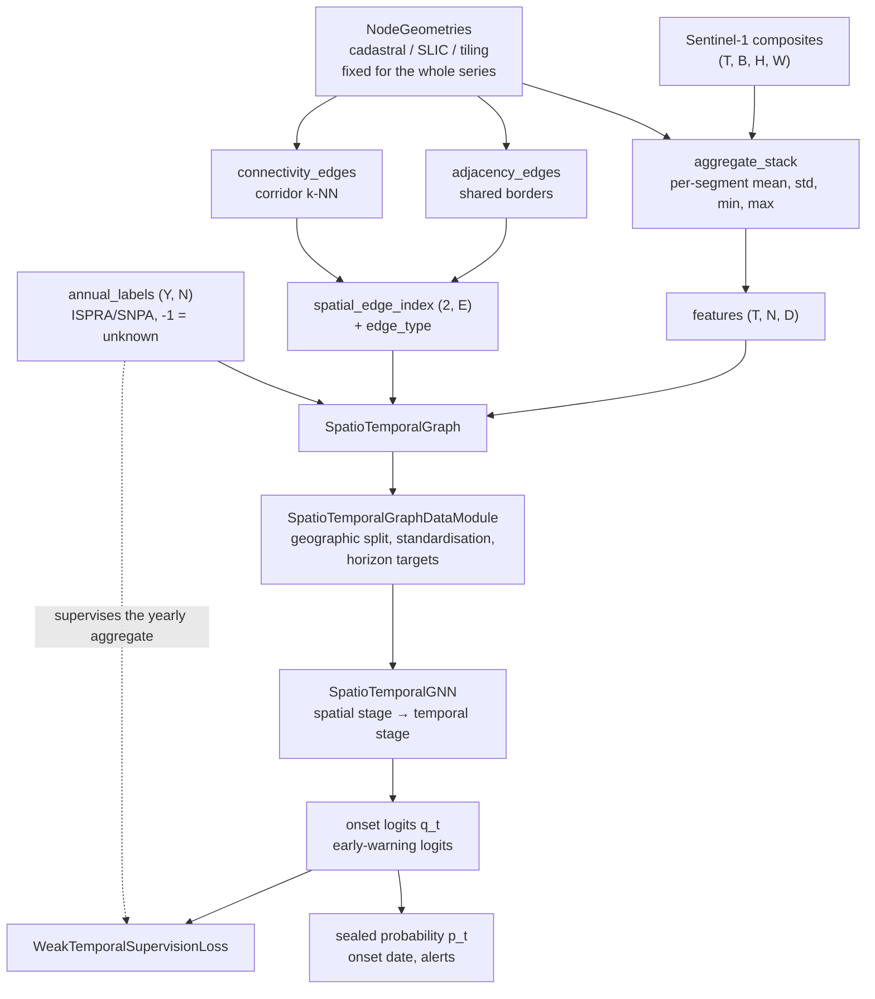

# Architecture

How the code is put together, and why. The research framing lives in
[`docs/proposta_dottorato_strutturata_v2.md`](docs/proposta_dottorato_strutturata_v2.md);
this document is about the implementation, and about the decisions inside it
that are not obvious.

## The pipeline



## Layers of the design

### 1. Node geometries are computed once

`NodeGeometries` (`data/segmentation.py`) owns a label image, centroids and
areas. It is built once per study area and never recomputed.

Recomputing SLIC per acquisition would move segment boundaries with the speckle,
so node `i` at `t` and node `i` at `t+1` would not be the same piece of ground
and every temporal edge would be meaningless. The proposal's stated mitigation —
a stable reference segmentation with time-varying features — is therefore
enforced by the type: geometries live outside the time axis, and
`aggregate_stack` is the only bridge from pixels to nodes.

Three ways to get them: `from_label_image` (a rasterised cadastral layer),
`regular_grid` (deterministic, dependency-free, what the tests use), and
`slic_geometries` (optional `scikit-image`). `rasterise` is the inverse — it is
how a node-level prediction becomes a map again.

### 2. Edges carry the hypothesis

`build_spatial_edges` (`data/graph.py`) returns an edge index *and* an edge
type, from two families:

- `EDGE_ADJACENCY` — segments sharing a 4-connected border. Computed by
  comparing shifted label images, so it is exact and costs one pass.
- `EDGE_CONNECTIVITY` — k-nearest centroids, optionally restricted to a
  `corridor` mask (nodes intersecting the road network). Both endpoints must be
  on the corridor, which is what "propagation along infrastructure" means;
  without the mask it degrades to plain proximity and the distinction from
  adjacency gets thin.

Adjacency wins any edge both families would produce, so the types stay a
partition of the edge set — a test asserts this.

### 3. Time is a causal block matrix

`temporal_edges(N, T, order)` emits `(t-k, i) → (t, i)` for `k` in `1..order`,
over the flattened index `t*N + i`. `block_diagonal` replicates the spatial
edges once per composite. `SpatioTemporalGraph.super_edge_index` puts the two
together, giving a block **lower-triangular** adjacency matrix.

`SpatioTemporalGNN` does not message-pass over that full graph. It runs the
spatial convolutions on the block-diagonal half — which is *identical* to
applying the same shared-weight convolution to each frame, in one kernel call —
and handles the temporal half with a recurrent or causally-masked attention
stage. The super-graph builder stays because it is the honest statement of what
the model's inductive bias is, and because a joint-message-passing variant would
consume it directly.

Causality is not a convention here, it is tested: perturbing the last composite
leaves every earlier logit bit-identical
(`test_the_past_never_depends_on_the_future`).

### 4. The model: two stages, one contract

```
features (T, N, D)
  → spatial stage: L × (SAGEConv | GATConv) on the block-diagonal edges, shared weights
  → temporal stage: unidirectional LSTM, or self-attention with a causal mask
  → detection head  → onset logits  q_t
  → early-warning head → "seals within the next h composites"
```

The stages are split rather than interleaved because that is what keeps the
model **inductive**: no node identity is learned, so the same weights apply to a
study area with a different node set — which is precisely what transferring
between Lazio and the Pianura Padana (objective OS4) requires. A test runs one
set of weights over two differently-sized graphs.

Every model in the project satisfies the same contract —
`(features, spatial_edge_index) -> STGNNOutput` — so `SoilSealingModule` trains
the full model and each ablation through the identical loop, loss and metrics.
The only thing that differs in the OS3 comparison is the model object.

There is deliberately **no input normalisation layer**. An early version applied
`LayerNorm` over the channel axis; because it centres each node-composite's
feature vector across channels, it erased the absolute backscatter level — a
large part of what separates sealed from natural ground. Measured cost on the
synthetic benchmark: annual F1 0.80 → 0.96 for the temporal ablation once it was
removed. Per-channel standardisation happens once, in the datamodule, fitted on
the training nodes only.

### 5. Onset parameterisation, and why it matters twice

The detection head predicts the per-composite **onset** probability `q_t`, not
the sealed state. The state is the cumulative noisy-OR:

```
log P(still unsealed at t) = Σ_{s≤t} log σ(−logit_s)      # cumsum of log-sigmoids
p_t = 1 − exp(that)                                        # non-decreasing in t
```

This buys two things at once.

**Irreversibility for free.** `p_t` is non-decreasing for any parameter values,
so the physical fact that soil sealing does not undo itself is a property of the
parameterisation rather than a soft penalty the optimiser can trade away. The
loss config therefore has no monotonicity weight.

**A weak-supervision objective that needs no invented dates.** The probability
that land take occurred *somewhere inside* year `y` is the same noisy-OR
restricted to that year's composites. So an annual label supervises a bag of
sub-annual predictions — a multiple-instance formulation — and the placement of
the transition inside the labelled year is never supervised. That is the
mismatch the proposal calls the critical node, and the test
`test_the_sub_annual_placement_inside_the_labelled_year_is_not_penalised` states
the resulting invariant exactly.

`aggregate_year_logit` also offers `max` (the hard MIL rule, gradient to one
composite) and `logsumexp` (a temperature-controlled interpolation) for
ablations. All three are computed in log space; the noisy-OR never forms a
product of probabilities and stays finite at ±60 logits, which a test checks
together with its gradient.

### 6. The loss, term by term

`WeakTemporalSupervisionLoss` returns a dict — `total` plus every component — so
each one is logged separately and can be read during training.

| Term | What it does | Default weight |
| --- | --- | --- |
| `weak_annual` | MIL cross-entropy: one bag per (node, year) | 1.0 |
| `smoothness` | Dirichlet energy of `q_t` over the spatial edges — the diffusion from certain to uncertain areas | 0.05 |
| `sparsity` | `relu(Σ_t q_t − 1)`: at most one onset per node over the series | 0.05 |
| `supervised` | Plain BCE on `p_t` where the exact date is known | 1.0 |
| `horizon` | BCE for the early-warning head | 0.5 |

`-1` means unknown everywhere and is skipped, never treated as a negative: a
node whose year is unlabelled is not a node where nothing happened. The
`weak_annual` term weights each year by how many labelled nodes it contributes,
so a year with sparse labels does not count as much as a full one.

### 7. Splits are geographic, not random

`SpatioTemporalGraph.split_nodes` sorts nodes by a centroid coordinate and cuts
bands along it. Sampling nodes at random would put a test node's immediate
neighbours in the training set, and the model is built to pass messages between
exactly those — the leakage would flatter it through the mechanism under test.
The standardiser is fitted on the training band only, for the same reason.

The consequence is that the whole study area is one batch and the splits are
**node masks**, not separate datasets; the datamodule serves the same graph
three times with a different mask.

### 8. Metrics say *when*, not just *whether*

`metrics/classification.py` gives the four the SNPA validation uses (OA, F1,
IoU, kappa), agreeing with scikit-learn to floating-point tolerance.

`metrics/delay.py` gives the ones this project actually claims:

- `detection_delay` — signed, in composites. Passing `n_time` charges an
  undetected node the remainder of the series, so a model cannot look punctual
  by staying silent on the hard cases.
- `onset_from_probability(..., min_persistence=k)` — require `k` consecutive
  composites above the threshold before emitting a detection, but report the
  *first* one. This is the delay-versus-robustness trade-off an operational
  chain has to make, made explicit.
- `early_warning_lead_time` — counts only alarms raised strictly *before* the
  transition, so anticipation is never scored as detection.

`SoilSealingModule` reports annual metrics always, and sub-annual metrics plus
delay **only** when exact dates exist. A sub-annual F1 computed against annual
labels would be measuring the model against a target that does not exist, so the
module simply does not produce one.

## Extension points

| To add | Where |
| --- | --- |
| Real Sentinel-1 | Produce `(T, B, H, W)` composites; `composite_by_period` already regularises an irregular revisit |
| Cadastral nodes | `NodeGeometries.from_label_image(rasterised_parcels)` |
| Sentinel-2 fusion | Concatenate optical channels into the `(T, N, D)` feature tensor |
| Real road corridors | Pass an OSM-derived `corridor` mask to `build_spatial_edges` |
| A new baseline | Any `nn.Module` returning `STGNNOutput`; register it in `training/cli.py` |
| Joint space-time message passing | Consume `SpatioTemporalGraph.super_edge_index` directly |
| Real annual labels | `(Y, N)` int array, `-1` for unknown, plus a `(T,)` `year_index` |

## Known limits

- The weak early-warning target (`annual_to_horizon_target`) is **coarse**: an
  annual label cannot localise a transition, so the target stays 1 across the
  whole land-take year, including composites after it. The head trained on it
  learns "a transition is near", not "a transition is `k` composites away". Use
  `state_to_horizon_target` wherever dates exist.
- Everything is full-batch. A national-scale graph will need the neighbour
  sampling that GraphSAGE was designed for; the model is inductive, so this is
  an addition to the data loader rather than a change of architecture.
- The synthetic generator reproduces topological propagation, a
  spread-over-time signature and weak labels — and nothing else. It is not a SAR
  simulator, and results on it are not evidence about real acquisitions.
