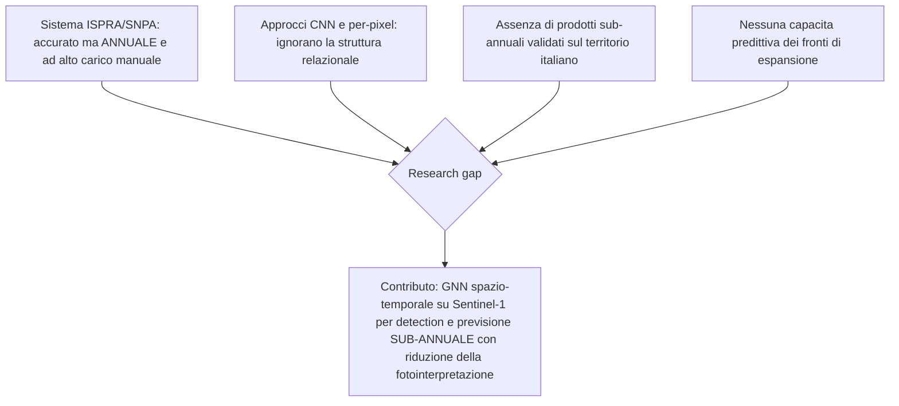
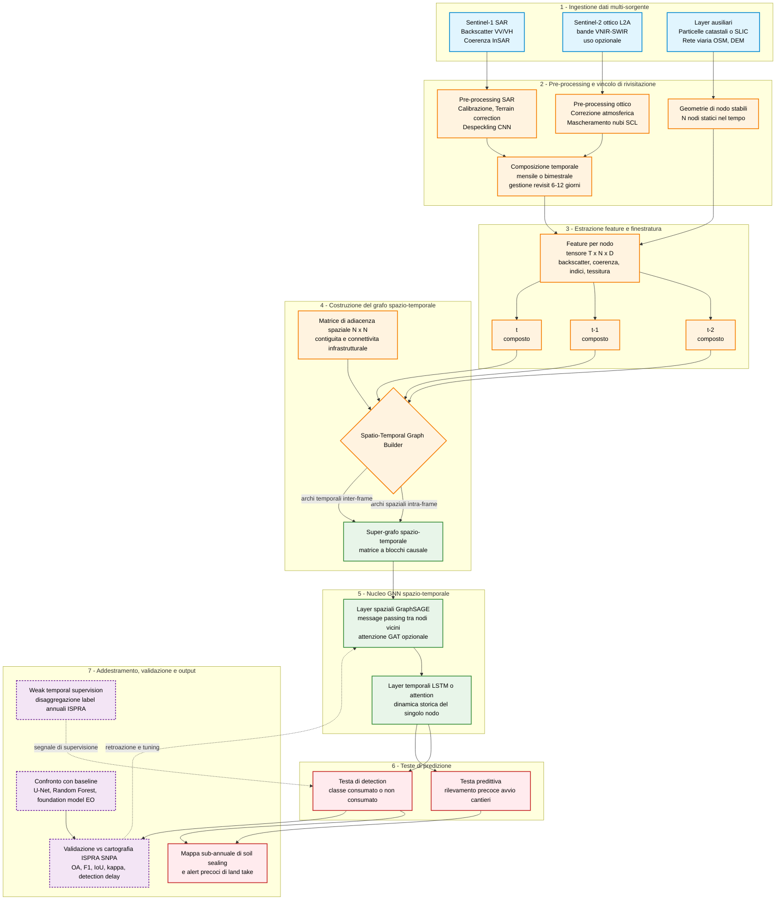
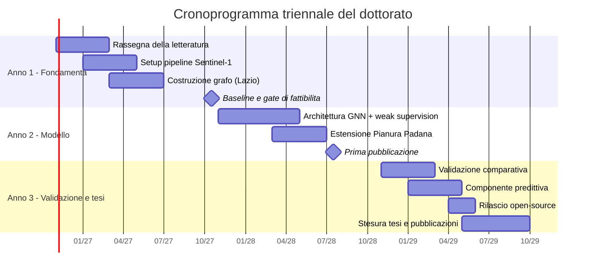

# Proposta di Progetto di Ricerca (PhD Proposal)

## 1. Reti neurali su grafo spazio-temporali per il monitoraggio sub-annuale e la previsione del consumo di suolo da serie multitemporali Sentinel-1 SAR

*Sottotitolo:* Un approccio relazionale alla detection e all'anticipazione della sigillazione del suolo (*soil sealing*), validato sulla cartografia ISPRA/SNPA — casi studio Lazio e Pianura Padana.

*Key-Words:* Graph Neural Networks · Synthetic Aperture Radar (Sentinel-1) · soil sealing / land take · change detection sub-annuale · weak supervision · Earth Observation.

---

## 2. Abstract

Il consumo di suolo è tra le principali pressioni ambientali sul territorio italiano: nel 2024 il consumo netto ha raggiunto 78,5 km², il valore più alto degli ultimi dodici anni. Il monitoraggio ufficiale di ISPRA/SNPA integra **già** dati radar Sentinel-1 e ottici Sentinel-2 in una classificazione semi-automatica seguita da estesa fotointerpretazione manuale, producendo però una cartografia a cadenza **esclusivamente annuale** e ad alto costo di lavoro esperto. Questo progetto propone una *Graph Neural Network* (GNN) spazio-temporale che modella il territorio come struttura relazionale — nodi corrispondenti a super-pixel o particelle, archi che codificano adiacenza spaziale e connettività infrastrutturale — per rilevare e **anticipare** la sigillazione del suolo a **risoluzione sub-annuale**, a partire da serie multitemporali Sentinel-1 con fusione ottica opzionale. Il contributo non consiste nell'introdurre il SAR, già impiegato da ISPRA, bensì: (i) portare la detection a scala sub-annuale; (ii) ridurre il carico di fotointerpretazione manuale mediante apprendimento relazionale automatizzato; (iii) abilitare una capacità predittiva dei fronti di espansione, ignorata dagli approcci per-pixel e convoluzionali. Il metodo sarà validato sulla cartografia ufficiale ISPRA/SNPA in due aree pilota complementari — Lazio (Roma e Viterbo) e Pianura Padana — quest'ultima penalizzata da copertura nuvolosa e nebbia che motivano un impianto *SAR-first*. Il progetto affronta esplicitamente il disallineamento fra etichette annuali e predizioni sub-annuali con strategie di *weak supervision*. L'impatto atteso è un sistema riproducibile e open-source, allineato agli obblighi di monitoraggio della Direttiva (UE) 2025/2360.

---

## 3. Introduzione e Background (Stato dell'Arte)

### 3.1 Inquadramento del problema

Il consumo di suolo — la transizione da superfici naturali o agricole a coperture artificiali, prevalentemente impermeabilizzate — è un processo in larga parte irreversibile che compromette servizi ecosistemici essenziali. Il Rapporto SNPA 2025 (Munafò, a cura di) documenta per il 2024 un consumo netto di **78,5 km²**, il più elevato degli ultimi dodici anni, con la copertura artificiale nazionale al **7,17%** del territorio contro una media UE del **4,4%**; segnala inoltre il fotovoltaico a terra come *driver* emergente, particolarmente rilevante nel **Lazio** (prima regione per superficie annua) e nella provincia di **Viterbo** (prima provincia, ~424 ha).

Il tema è sospinto dal quadro normativo europeo: la **Direttiva (UE) 2025/2360** sul monitoraggio e la resilienza del suolo (*Soil Monitoring Law*), il **Regolamento (UE) 2024/1991** sul ripristino della natura e l'obiettivo strategico di *no net land take by 2050*. Un monitoraggio a maggiore frequenza temporale e minore intensità di lavoro manuale è un abilitatore diretto degli obblighi di rendicontazione introdotti da questo quadro.

### 3.2 La metodologia ISPRA/SNPA come è realmente

È essenziale caratterizzare correttamente il sistema ufficiale, per definire con precisione lo spazio di contributo. La cartografia ISPRA del consumo di suolo è prodotta a **10 m**, aggiornata **annualmente**, mediante una classificazione semi-automatica che utilizza **congiuntamente Sentinel-1 (SAR) e Sentinel-2 (ottico)**, seguita da un'estesa fase di **fotointerpretazione manuale** a cura degli operatori regionali del SNPA e validata su una rete di controllo (≈190.000 punti, uso campionario/validazione). Ne consegue che il progetto **non** deve posizionarsi come "introduzione del SAR" — assunzione errata — bensì sugli assi dove il sistema ha margini: **granularità temporale** e **intensità del lavoro esperto**.

### 3.3 Letteratura di riferimento

- **Fondamenti GNN:** ChebNet (Defferrard et al., NIPS 2016); GCN (Kipf & Welling, ICLR 2017); GraphSAGE, apprendimento induttivo scalabile (Hamilton, Ying & Leskovec, NeurIPS 2017); GAT (Veličković et al., ICLR 2018).
- **GNN per Earth Observation:** Kavran et al. (*Sensors*, 2023, DOI 10.3390/s23146648) impiegano GraphSAGE su super-pixel per il mapping spazio-temporale della copertura del suolo da Sentinel-2. *Nota critica:* il lavoro STAG-NN-BA (Nazir et al., **arXiv:2303.14322**) è un **preprint non peer-reviewed**, citato come indicazione di direzione e non come evidenza consolidata.
- **SAR change detection:** sensibilità del *backscatter* in banda C a cantieri ed edificato; *InSAR coherence* per la detection dei cambiamenti strutturali; persistenza temporale come *proxy* di permanenza. In questa direzione si farà riferimento a lavori peer-reviewed su change detection urbano basati su coerenza InSAR e su approcci SAR per il monitoraggio di edificato e cantieri, integrati con la letteratura sulla persistenza temporale come indicatore di stabilità.
- **Segmentazione:** super-pixel SLIC (Achanta et al., *IEEE TPAMI*, 2012).
- **Fusione SAR-ottico e foundation model EO:** lavori del gruppo TUM/DLR (Schmitt & Zhu); *foundation model* geospaziali (Prithvi, Presto, Clay) come baseline e opportunità di *transfer learning*.

### 3.4 Research gap

L'ipotesi scientifica è che il consumo di suolo sia un processo **topologicamente strutturato** (propagazione lungo infrastrutture, addensamento ai margini urbani), mal rappresentato dalle architetture convoluzionali su griglia euclidea. Il *gap* nasce dalla convergenza di quattro carenze:

---

## 4. Obiettivi della Ricerca

**Obiettivo principale (OP).** Progettare, addestrare e validare una GNN spazio-temporale che, da serie multitemporali Sentinel-1 (con fusione Sentinel-2 opzionale), rilevi e anticipi la sigillazione del suolo a risoluzione sub-annuale con affidabilità comparabile alla cartografia annuale ISPRA/SNPA.

**Obiettivi specifici (OS):**

1. **OS1 — Pipeline dato→grafo.** Definire una pipeline riproducibile dal pre-processing SAR alla costruzione del grafo spazio-temporale (nodi, archi, feature), robusta all'instabilità dei super-pixel indotta dallo *speckle*.
2. **OS2 — Modello e weak supervision.** Sviluppare un'architettura GNN induttiva e una strategia di *disaggregazione temporale* delle etichette annuali per abilitare predizioni sub-annuali.
3. **OS3 — Validazione comparativa.** Quantificare il guadagno della rappresentazione a grafo rispetto a baseline forti (CNN siamese, random forest, modelli temporali non-grafo, foundation model EO) sulla cartografia ISPRA/SNPA.
4. **OS4 — Impatto operativo e trasferibilità.** Misurare la riduzione del carico di fotointerpretazione e la trasferibilità del modello tra le due aree pilota; rilasciare codice e dataset in forma aperta.

---

## 5. Metodologia

Approccio **quantitativo e sperimentale**, articolato in cinque fasi.

```mermaid
flowchart LR
    subgraph F1["Fase 1 - Dati e pre-processing"]
        A1["Sentinel-1 GRD IW VV+VH"] --> A2["Calibrazione, terrain correction, despeckling"]
        A3["Sentinel-2 L2A opzionale"] --> A2
        A2 --> A4["Feature: backscatter, coherence, tessitura"]
    end
    subgraph F2["Fase 2 - Costruzione del grafo"]
        A4 --> B1["Segmentazione SLIC o particelle catastali"]
        B1 --> B2["Nodi = segmenti; Archi = adiacenza e connettivita"]
        B2 --> B3["Grafo spazio-temporale"]
    end
    subgraph F3["Fase 3 - Modello"]
        B3 --> C1["GNN induttiva GraphSAGE con attenzione"]
        C1 --> C2["Weak supervision e disaggregazione etichette annuali"]
    end
    subgraph F4["Fase 4 - Validazione"]
        C2 --> D1["Confronto con baseline"]
        D1 --> D2["Metriche: OA, F1, IoU, kappa, detection delay"]
        D2 --> D3["Ground truth ISPRA/SNPA"]
    end
    subgraph F5["Fase 5 - Impatto"]
        D3 --> E1["Riduzione fotointerpretazione; trasferibilita; rilascio open-source"]
    end
```

### 5.1 Dati e pre-processing (strumenti)

Sorgente primaria **Sentinel-1 GRD IW (VV+VH, 10 m)** via *Copernicus Data Space Ecosystem* e piattaforme di *Analysis Ready Data*. Pre-processing: calibrazione radiometrica, *Range-Doppler terrain correction*, filtraggio dello *speckle*, composizioni temporali; ove utile, calcolo della **coherence** InSAR come feature di persistenza. Fusione **Sentinel-2 L2A** attivata selettivamente in funzione della copertura nuvolosa. *Stack* tecnologico previsto: SNAP/`snappy`, Python (PyTorch, PyTorch Geometric o DGL), GDAL/`rasterio`, `scikit-image` (SLIC).

### 5.2 Costruzione del grafo

Segmentazione in super-pixel (**SLIC** su feature radar aggregate) o ancoraggio alla **geometria catastale**, per ottenere nodi stabili e interpretabili. Feature di nodo: statistiche multitemporali VV/VH, tessitura (GLCM), coherence, attributi geometrici, prossimità a viabilità ed edificato. Archi: adiacenza spaziale e connettività infrastrutturale. *Mitigazione del rischio* di instabilità temporale dei super-pixel: **segmentazione di riferimento stabile** (multitemporale o catastale) con feature variabili nel tempo su nodi fissi, così da disaccoppiare la topologia dalla dinamica del segnale.

*(La costruzione del grafo è illustrata, nel quadro dell'intera pipeline, dalla **Figura 2** al §5.3.)*

### 5.3 Architettura e weak supervision

Ossatura **induttiva GraphSAGE** (scalabilità e trasferibilità via *neighbor sampling*), eventualmente con attenzione **GAT** sugli archi, e modulo temporale (LSTM/attention). Il nodo critico è il disallineamento **etichette annuali → predizioni sub-annuali**: si adotteranno strategie di *weak supervision* e **disaggregazione temporale**, in cui l'etichetta annuale vincola l'aggregato della sequenza infra-annuale e la propagazione sul grafo diffonde il segnale dalle aree certe a quelle incerte, richiamando approcci di temporal-label learning già consolidati nella letteratura di machine learning e remote sensing.

**Figura 2 — Architettura end-to-end del sistema proposto.** Dal dato multi-sorgente alla mappa sub-annuale: si notino la componente stabile delle geometrie di nodo, il super-grafo spazio-temporale a blocchi causale, il nucleo GNN a due stadi (spaziale GraphSAGE + temporale) e la separazione fra il flusso di inferenza (continuo) e i segnali di addestramento/validazione (tratteggiati).

### 5.4 Protocollo sperimentale, baseline e metriche

Baseline: (a) *change detection* convoluzionale per-pixel (U-Net siamese); (b) **random forest** su feature di serie temporale; (c) modelli temporali non-grafo (LSTM/Transformer); (d) *foundation model* EO (Prithvi/Presto/Clay) messi a punto. Metriche: **Overall Accuracy, F1, IoU, kappa**, più **detection delay** per la componente sub-annuale e predittiva. Validazione su cartografia ISPRA/SNPA con **separazione spaziale** rigorosa training/test per evitare *leakage*.

### 5.5 Aree pilota

- **Lazio (Roma–Viterbo):** espansione peri-urbana frammentata + pressione da fotovoltaico a terra (Tarquinia, Montalto di Castro). Riferimento ausiliario: Carta dell'Uso del Suolo regionale.
- **Pianura Padana (Lombardia/Emilia-Romagna):** fronte intenso di logistica e infrastrutture; **elevata frequenza di nubi/nebbia** che motiva l'impianto SAR-first. Riferimenti ausiliari: **DUSAF** (Lombardia), database di uso del suolo dell'Emilia-Romagna.

---

## 6. Risultati Attesi e Impatto

**Contributo originale:**

- **Metodologico** — una GNN spazio-temporale validata per la detection **sub-annuale** della sigillazione, con evidenza quantitativa del contributo della rappresentazione relazionale rispetto alle baseline.
- **Operativo** — una stima **misurabile** della riduzione del carico di fotointerpretazione, di interesse diretto per il flusso SNPA.
- **Predittivo** — un modello capace di **anticipare** i fronti di espansione a partire dalla topologia del processo.
- **Istituzionale** — allineamento agli obblighi di monitoraggio di *soil sealing* della **Direttiva (UE) 2025/2360** e potenziale collaborazione con ISPRA/SNPA.
- **Scientifico e aperto** — rilascio *open-source* di codice e dataset derivati; pubblicazioni su sedi di settore (IEEE TGRS, ISPRS Journal of Photogrammetry and Remote Sensing, IEEE JSTARS, *Remote Sensing*).

**Impatto atteso:** transizione da un monitoraggio annuale e labour-intensive a un supporto sub-annuale, automatizzato e predittivo, a beneficio della pianificazione territoriale e della rendicontazione europea.

---

## 7. Cronoprogramma (Timeline)

**1° anno** — Rassegna sistematica, setup della pipeline Sentinel-1, costruzione del grafo su sotto-ambito del Lazio, baseline; **gate di fattibilità** a fine anno (la GNN deve superare le baseline per-pixel su caso ristretto).
**2° anno** — Architettura completa + weak supervision; estensione alla Pianura Padana; raccolta risultati; prima pubblicazione.
**3° anno** — Validazione comparativa su entrambe le aree, componente predittiva, quantificazione della riduzione di fotointerpretazione; rilascio open-source; stesura tesi e pubblicazioni finali.

> *Nota:* le date sono indicative e da allineare all'effettiva data di avvio.

---

### Riferimenti essenziali (verificati)

- Achanta R. et al. (2012). *SLIC Superpixels…* **IEEE TPAMI** 34(11), 2274–2282.
- Defferrard M., Bresson X., Vandergheynst P. (2016). *ChebNet.* **NIPS** 29.
- Kipf T. N., Welling M. (2017). *Semi-Supervised Classification with GCN.* **ICLR**.
- Hamilton W. L., Ying R., Leskovec J. (2017). *Inductive Representation Learning on Large Graphs (GraphSAGE).* **NeurIPS** 30.
- Veličković P. et al. (2018). *Graph Attention Networks.* **ICLR**.
- Kavran D., Mongus D., Žalik B., Lukač N. (2023). *GNN-Based Spatiotemporal Land Cover Mapping.* **Sensors** 23(14), 6648. DOI 10.3390/s23146648.
- Nazir U. et al. (2023). *STAG-NN-BA.* **arXiv:2303.14322** *(preprint — non peer-reviewed).*
- Munafò M. (a cura di) (2025). *Consumo di suolo, dinamiche territoriali e servizi ecosistemici. Ed. 2025.* **Report SNPA — ISPRA**.
- **Direttiva (UE) 2025/2360** (Soil Monitoring Law); **Regolamento (UE) 2024/1991** (Nature Restoration). *EUR-Lex.*
- ESA/Copernicus — *Sentinel-1 & Sentinel-2 User Guides*; stato costellazione (S1B fine missione 2022; S1C lancio dic. 2024).

>La bibliografia sarà ulteriormente arricchita con contributi su change detection urbano basato su coerenza, weak/temporal-label learning e foundation model EO, in funzione della selezione finale dei lavori da citare.
